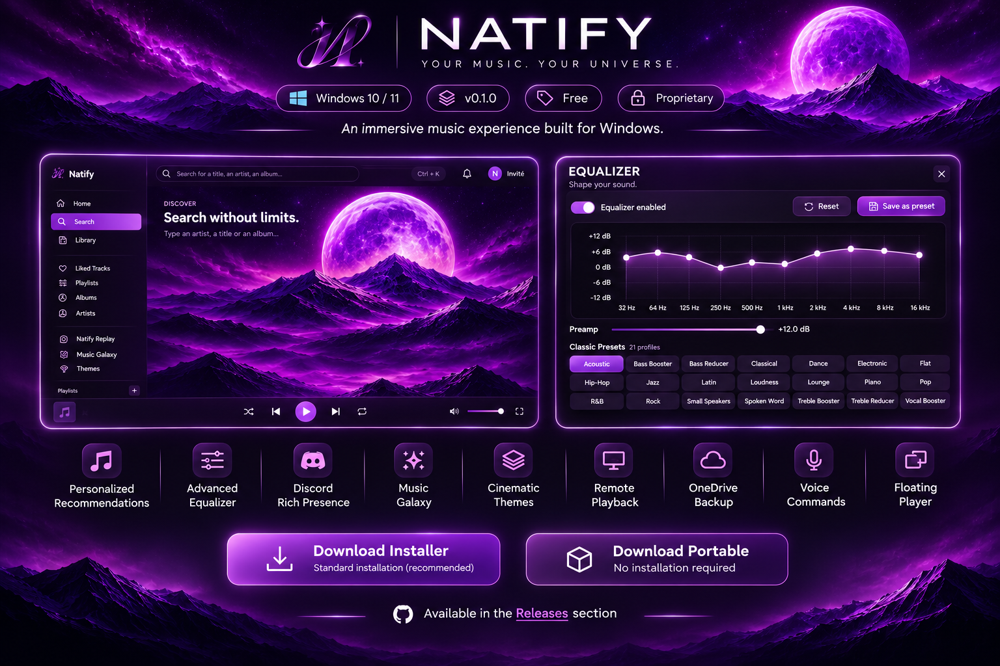

# N A T I F Y

### Your music. Your universe.

**An immersive music experience built for Windows.**

 

  

[Features](#features) |
[Installation](#installation) |
[Requirements](#requirements) |
[Releases](../../releases)

---

## Experience Natify

---

## Features

<table>
<tr>
<td width="50%" valign="top">

<h3>Music Experience</h3>

- Personalized recommendations
- Music discovery
- Synchronized lyrics
- Playlists and favorites
- Dynamic album artwork
- Natify Replay
- Local audio playback

</td>
<td width="50%" valign="top">

<h3>Audio & Immersion</h3>

- Advanced equalizer
- 21 equalizer presets
- Cinematic themes
- Interactive Music Galaxy
- Real-time audio visualizer
- Smart audio transitions
- Custom audio presets

</td>
</tr>
<tr>
<td width="50%" valign="top">

<h3>Connectivity</h3>

- Discord Rich Presence
- Remote playback control
- OneDrive backup
- Optional account connection

</td>
<td width="50%" valign="top">

<h3>Desktop Experience</h3>

- Floating music player
- Gaming mode
- Voice commands
- Portable edition

</td>
</tr>
</table>

---

## Installation

| Edition | Platform | Installation |
|---|---|---|
| **Windows Installer** | Windows x64 | Standard installation |
| **Portable Edition** | Windows x64 | Extract and launch |

Both editions are available in the [Releases](../../releases) section once published.

## Requirements

- Windows 10 or Windows 11 (64-bit)
- Internet connection for online music
- Discord Desktop for optional Rich Presence

No separate Node.js installation required.

---

## Privacy

Discord activity sharing is optional.

## Copyright

Copyright 2026 Natify. All rights reserved.

Natify is proprietary software.
Third-party components retain their respective licenses.

Promotional artwork is illustrative.

---

### Your music. Your universe.

